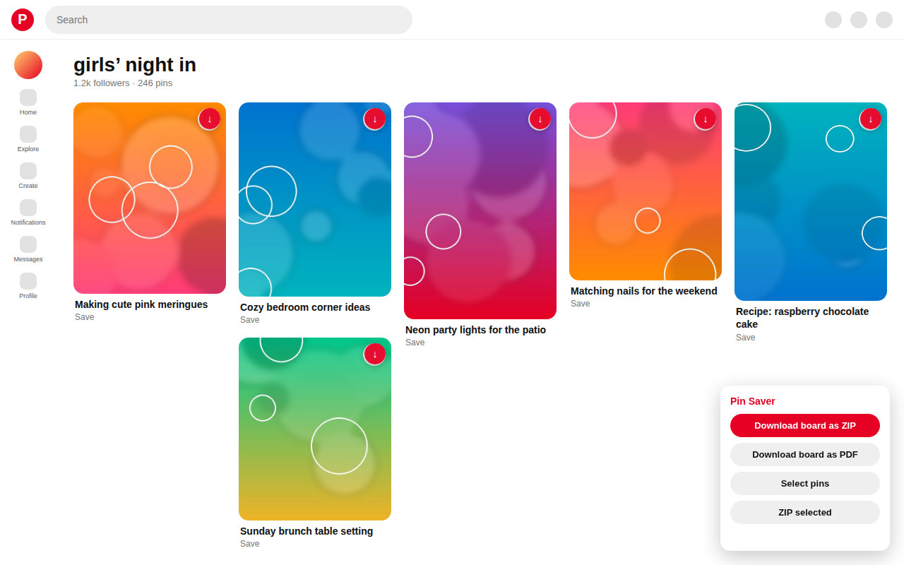
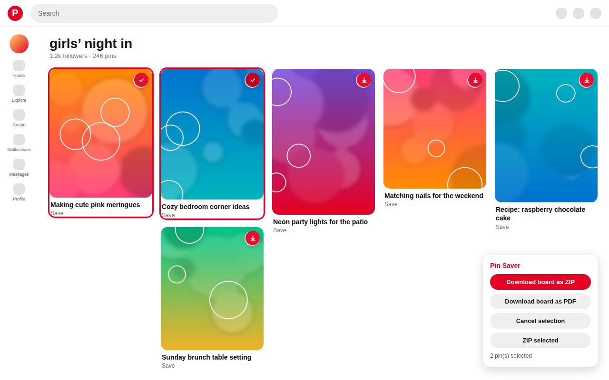
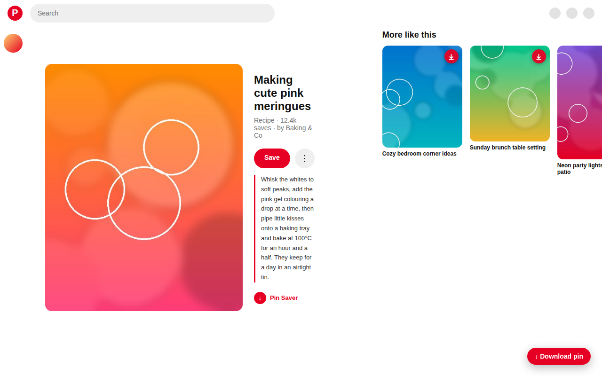

# Pin Saver — Pinterest Board Downloader

A Chrome extension (Manifest V3) that saves an entire Pinterest board to your
computer as a **ZIP archive** or a **PDF** — original-resolution images, real
playable **MP4 videos**, and the board's **sections kept as folders**.

**No account, no server, no telemetry, zero runtime dependencies.** The
extension is ~2,900 lines of plain JavaScript.

<p align="center">
  
</p>

---

## What it does

| Feature | Detail |
|---|---|
| **Board → ZIP** | every pin, at Pinterest's *originals* resolution |
| **Board → PDF** | one page per image, A4, JPEG embedded losslessly |
| **Videos** | the real fragmented MP4, not an `.m3u8` playlist |
| **Sections** | each board section becomes a folder in the archive |
| **Single pin** | a download button on every pin card and on the pin page |
| **Select pins** | tick the pins you want, export only those |
| **Metadata** | `_metadata.csv` + `_metadata.json` per archive |
| **Any domain** | `pinterest.com`, `www.`, and every country domain |
| **Your session** | uses the Pinterest sign-in already in your browser |

<p align="center">
  
  
</p>

---

## Install

### From a release

Grab **[pin-saver-extension.zip](https://github.com/horizonbymuneeb/pin-saver/releases/download/v1.0.0/pin-saver-extension.zip)** (37 KB, 19 files), then:

1. Unzip it.
2. Open `chrome://extensions`.
3. Turn on **Developer mode** (top right).
4. Click **Load unpacked** and select the unzipped folder.
5. Open a Pinterest board — a small *Pin Saver* panel appears bottom-right.

### From source

```bash
git clone https://github.com/horizonbymuneeb/pin-saver.git
cd pin-saver
npm install          # dev tooling only; the extension itself has no deps
npm run package      # writes ../pin-saver-extension.zip
```

### Chrome Web Store

The extension is packaged for the Chrome Web Store. A release asset is
published at
[releases/download/v1.0.0](https://github.com/horizonbymuneeb/pin-saver/releases/download/v1.0.0/pin-saver-extension.zip).

---

## How it works

Pinterest's own front-end reads a board through an internal JSON API. Pin Saver
uses the same endpoints, so it can read a complete board without scrolling the
page and without depending on the DOM:

```
GET https://www.pinterest.com/resource/BoardResource/get/
      ?source_url=/<user>/<board>/
      &data={"options":{"username":"…","slug":"…","field_set_key":"detailed"}}
```

with Pinterest's own browser headers (`x-app-version`, `x-pinterest-appstate`,
`x-b3-*` trace ids, `x-requested-with`). The response carries the board id,
which feeds the feed and section endpoints:

| Endpoint | Purpose |
|---|---|
| `BoardResource` | resolve `/user/board/` → numeric board id |
| `BoardFeedResource` | page through the board's pins (`bookmark` cursor) |
| `BoardSectionsResource` | list the board's sections |
| `BoardSectionPinsResource` | page through one section's pins |

A board's plain feed carries **no** section information, so a board with
sections has to be read section by section — that is the only way to get the
folder structure right.

**Images** come from `i.pinimg.com`; the `/236x/` bucket in the URL is rewritten
to `/originals/`. **Videos** are only published as an HLS `.m3u8`; Pin Saver
parses the master playlist, picks the media playlist and downloads the backing
`<hash>_1w.cmfv` — a complete fragmented MP4 that plays anywhere.

All API calls are made by the **background service worker**, which holds the
host permissions. That matters: a content script fetching `www.pinterest.com`
from a page on `in.pinterest.com` is a cross-origin request, the browser
preflights it, Pinterest answers the preflight with HTTP 400 and no
`Access-Control-Allow-Origin`, and the request dies with a bare
`Failed to fetch`. The service worker is not subject to CORS, so the extension
behaves the same on every Pinterest host.

Full details, including every failure mode and the reasoning behind each
decision, are in [`SPEC.md`](SPEC.md).

---

## Project layout

```
manifest.json        MV3 manifest
src/
  background.js      service worker: API calls, media fetch, downloads
  content.js         the panel, per-pin buttons, board/PDF export
  content.css        injected styles
  lib/
    api.js           Pinterest resource API client
    util.js          URL/title/selection helpers, CSV writer
    zip.js           dependency-free store-only ZIP writer
    pdf.js           dependency-free PDF writer
    video.js         HLS playlist parsing
popup/               toolbar popup
test/                node:test suites (104 tests)
test/e2e/            real-Chromium harness with a mock Pinterest
scripts/             live checks, packaging, store tooling
```

---

## Development

```bash
npm test                 # 104 unit + integration tests (offline)
npm run test:e2e         # 51 checks in a real Chromium, against a mock Pinterest
npm run test:live        # live production Pinterest API smoke test
npm run check            # manifest / path / syntax validation
npm run package          # build the installable zip
npm run store:check      # Chrome Web Store policy + listing validation
```

The e2e harness boots a **mock Pinterest** over HTTPS on `localhost:8443`
(self-signed certificate) and drives the real extension inside a real
Chromium: it loads the extension, opens a board, clicks the buttons, and
inspects the bytes that land in the download directory. The mock also
injects failures on purpose — a media asset that answers HTTP 503 twice, a
board feed that answers HTTP 500 once, a video whose playlist 404s, a signed-out
login wall — so the error paths are covered too.

---

## Privacy

The extension collects nothing, stores nothing and has no server. It contacts
only `pinterest.com` (to read the board you are viewing) and `*.pinimg.com`
(to download the media), using the sign-in already present in your browser. It
never reads or stores a cookie value.

Full policy: [`docs/PRIVACY.md`](docs/PRIVACY.md) · also published at
<https://horizonbymuneeb.github.io/pin-saver-privacy/>

## Permissions

| Permission | Why |
|---|---|
| `activeTab` | show the download panel on the page you opened |
| `downloads` | write the ZIP / PDF into your own Downloads folder |

## Licence

MIT — see [`LICENSE`](LICENSE).
